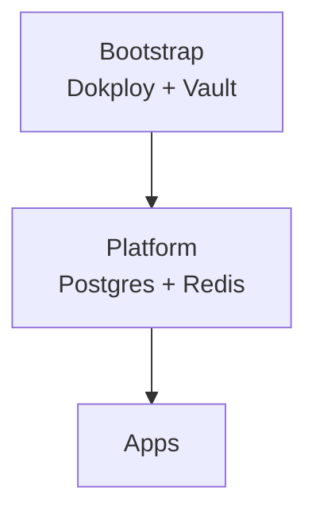

# 数据库总览 SSOT

> **SSOT Key**: `db.overview`
> **核心定义**: 定义平台数据库能力分布、依赖关系及凭据管理模型。

---

## 1. 真理来源 (The Source)

> **原则**：服务定义在 Compose，凭据由 Vault 管理。

| 维度 | 物理位置 (SSOT) | 说明 |
|------|----------------|------|
| **PostgreSQL** | [`platform/01.postgres/compose.yaml`](https://github.com/wangzitian0/infra2/blob/main/platform/01.postgres/compose.yaml) | 平台共享数据库 |
| **Redis** | [`platform/02.redis/compose.yaml`](https://github.com/wangzitian0/infra2/blob/main/platform/02.redis/compose.yaml) | 平台共享缓存 |
| **凭据管理** | **Vault** (`secret/<project>/<env>/<service>`) | 密钥真理 |
| **环境工具** | [`tools/env_tool.py`](https://github.com/wangzitian0/infra2/blob/main/tools/env_tool.py) | 远端读写 |

---

## 2. 架构模型



### 关键决策 (Architecture Decision)

- **静态凭据**: 以 Vault KV 为准，部署时注入到 Dokploy Env。
- **平台共享**: PostgreSQL/Redis 为平台服务复用。

---

## 3. 设计约束 (Dos & Don'ts)

### ✅ 推荐模式 (Whitelist)

- **模式 A**: 密码必须写入 Vault，再由部署流程读取。
- **模式 B**: 所有数据目录落盘到 `/data/platform/<service>${ENV_SUFFIX}/`。

### ⛔ 禁止模式 (Blacklist)

- **反模式 A**: **严禁** 多个应用共用同一数据库用户（除非明确审批）。
- **反模式 B**: **禁止** 在应用配置中硬编码数据库密码。

---

## 4. 标准操作程序 (Playbooks)

### SOP-001: 验证数据库可达性

- **触发条件**: 应用反馈无法连接数据库
- **步骤**:
    1. 使用平台状态任务验证底层实例健康（不暴露或复用平台级 `root` 账号，应用侧独立凭据规范见 [`db.vault-integration.md`](./db.vault-integration.md#禁止模式-blacklist)）：
       ```bash
       DEPLOY_ENV=<env> invoke postgres.shared.status
       DEPLOY_ENV=<env> invoke redis.shared.status
       ```
    2. 如需排查特定应用角色连接，读取该应用自身的 Vault 凭据路径 `secret/data/<project>/<env>/<service>` 进行验证。

---

## 5. 验证与测试 (The Proof)

| 行为描述 | 验证方式 | 状态 |
|----------|----------|------|
| **Postgres 服务健康** | `DEPLOY_ENV=<env> invoke postgres.shared.status` | ✅ Manual |
| **Redis 服务健康** | `DEPLOY_ENV=<env> invoke redis.shared.status` | ✅ Manual |

---

## Used by

- [docs/ssot/README.md](./README.md)
